# Hey, I'm Ammaar 👋

**I build and ship software: mobile apps, web platforms and tools that solve everyday problems.**

I'm a software developer with a computer systems engineering background, based in Auckland, New Zealand. From interfaces and cloud services to embedded devices, I enjoy turning ideas into working products. I use LLMs and generative AI in my development workflow to build faster, explore ideas and work through problems.

<a href="#what-i-work-with">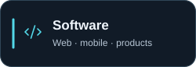</a> &nbsp;&nbsp;
<a href="#what-i-work-with">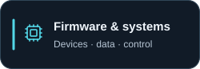</a> &nbsp;&nbsp;
<a href="#what-i-work-with">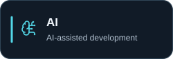</a>

[Selected work](#selected-work) · [Technology & experience](#what-i-work-with) · [Connect on LinkedIn](https://www.linkedin.com/in/ammaar-marzook-nz/)

## Core toolkit

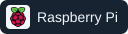

These are the main technologies I work with. [See the full toolkit and experience below ↓](#what-i-work-with)

## Selected work

A few things I've built. **Start with the lab**, or explore whichever catches your eye.

<table>
<tr>
<td width="50%" valign="top">
<h3>Remote Experiment Control Lab</h3>
<a href="https://github.com/ammaar134/Remote-Expriment-Control-Lab/blob/main/docs/WALKTHROUGH.md">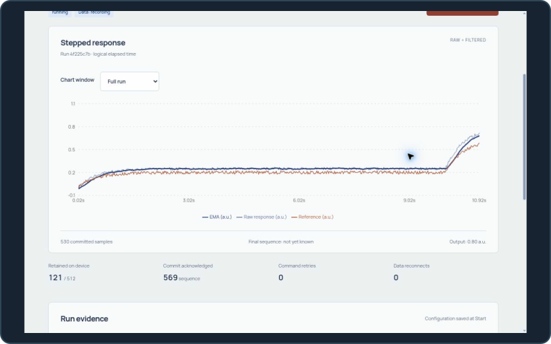</a>

Configure simulated experiments, watch measurements live and replay saved results.

React · TypeScript · Python / FastAPI C++ simulation engines · PostgreSQL

<a href="https://github.com/ammaar134/Remote-Expriment-Control-Lab/blob/main/docs/WALKTHROUGH.md"><strong>Take a tour ↗</strong></a> · <a href="https://github.com/ammaar134/Remote-Expriment-Control-Lab">Source</a>

Simulator. Hosted access is operator-only.
</td>
<td width="50%" valign="top">
<h3>Fieldroom Equipment lending</h3>
<a href="https://github.com/ammaar134/Live-Event-Operations/blob/main/docs/CASE-STUDY.md">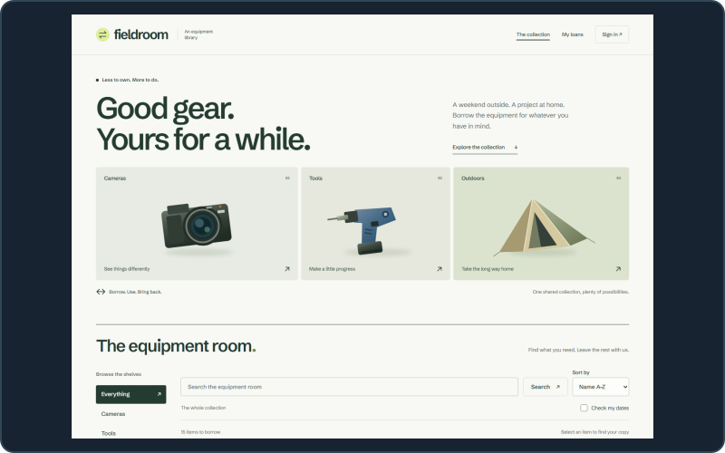</a>

Help a club book, lend and maintain shared equipment without double bookings.

React · TypeScript · C# / ASP.NET Core Identity · EF Core · PostgreSQL

<a href="https://github.com/ammaar134/Live-Event-Operations/blob/main/docs/CASE-STUDY.md"><strong>Explore the app ↗</strong></a> · <a href="https://github.com/ammaar134/Live-Event-Operations">Source</a>

Portfolio application for a fictional club.
</td>
</tr>
<tr>
<td width="50%" valign="top">
<h3>EduFeed A more focused YouTube</h3>
<a href="https://chromewebstore.google.com/detail/edufeed-%E2%80%93-productive-yout/cpppgdcmmigbddkhaaifjfmogcppoknd">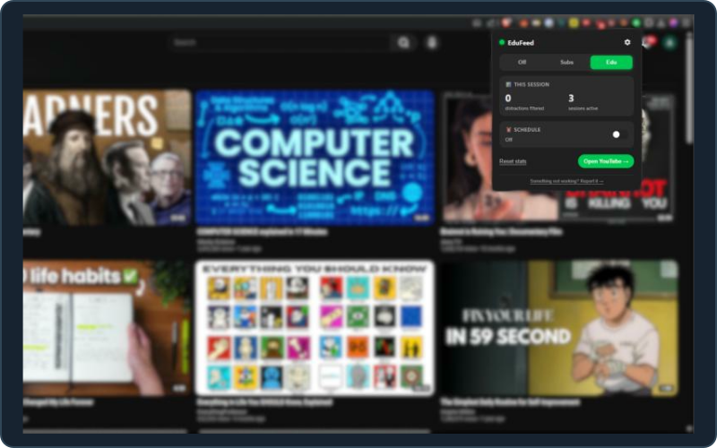</a>

Swap suggested videos for subscriptions or educational content to stay focused.

JavaScript · HTML / CSS · Manifest V3

<a href="https://chromewebstore.google.com/detail/edufeed-%E2%80%93-productive-yout/cpppgdcmmigbddkhaaifjfmogcppoknd"><strong>Install for Chrome ↗</strong></a> · <a href="https://github.com/ammaar134/edufeed">Source</a>

<a href="https://github.com/ammaar134/edufeed#the-three-modes">Explore the focus modes</a>
</td>
<td width="50%" valign="top">
<h3>More to come Always building</h3>
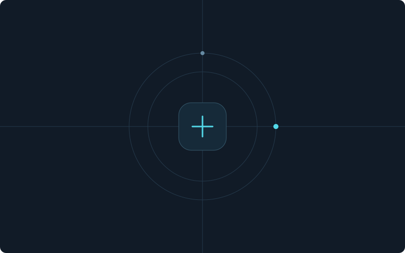

More ideas, experiments and useful things to share.

<a href="https://github.com/ammaar134?tab=repositories"><strong>Browse my repositories ↗</strong></a>

</td>
</tr>
</table>

<strong>Under the hood</strong> · architecture, tests & engineering decisions

### Remote Experiment Control Lab

**React UI → FastAPI → C++ engines** · PostgreSQL recording

Repeatable simulations, safe command retries and saved-data replay. Stop and fault handling zero the **simulated** output; recordings acknowledge samples after database commit.

[Architecture](https://github.com/ammaar134/Remote-Expriment-Control-Lab/blob/main/docs/ARCHITECTURE.md) · [Command path](https://github.com/ammaar134/Remote-Expriment-Control-Lab/blob/main/backend/lab/instrument.py) · [Engine tests](https://github.com/ammaar134/Remote-Expriment-Control-Lab/blob/main/instrument/tests/engine_test.cpp) · [CI](https://github.com/ammaar134/Remote-Expriment-Control-Lab/actions/workflows/ci.yml)

### Fieldroom

**React UI → ASP.NET Core + Identity → EF Core + PostgreSQL**

The database rejects overlapping reservations. Booking changes, audit history and retry outcomes commit together, with concurrent-booking tests against a real database.

[Architecture](https://github.com/ammaar134/Live-Event-Operations/blob/main/docs/ARCHITECTURE.md) · [Allocation service](https://github.com/ammaar134/Live-Event-Operations/blob/main/src/Api/Features/AllocationService.cs) · [Concurrency tests](https://github.com/ammaar134/Live-Event-Operations/blob/main/tests/Api.Tests/ConcurrencyTests.cs) · [CI](https://github.com/ammaar134/Live-Event-Operations/actions/workflows/verify.yml)

### EduFeed

**Extension controls → YouTube content scripts** · Local preferences

Focus modes and distraction filters adapt to YouTube's in-page navigation. Preferences stay in browser storage. YouTube layout changes can affect the extension.

[Feed replacement](https://github.com/ammaar134/edufeed/blob/main/src/content/feed-replacer.js) · [Manifest](https://github.com/ammaar134/edufeed/blob/main/manifest.json) · [Utility tests](https://github.com/ammaar134/edufeed/blob/main/test/utils.test.js)

The Chrome Web Store listing is live. The source README still has outdated release wording and missing demo/icon assets; the store package has not been matched to this source revision.

## What I work with

Across professional work, personal projects and engineering coursework. The projects above are a selection, not the full toolkit.

### Languages & foundations

 &nbsp;  &nbsp;  &nbsp;  &nbsp;  &nbsp;  &nbsp;  &nbsp;  &nbsp;  &nbsp;  &nbsp;  &nbsp; 

TypeScript · JavaScript · Python · Java · Dart · C · C++ · C# · HTML · CSS · SQL · PHP · Solidity

### Web & mobile

 &nbsp;  &nbsp;  &nbsp;  &nbsp;  &nbsp; 

React · React Native · Flutter · FastAPI · ASP.NET Core / Identity · EF Core

Also used: Vue · Angular · Shopify integrations.

### Cloud, data & delivery

 &nbsp;  &nbsp;  &nbsp;  &nbsp;  &nbsp;  &nbsp;  &nbsp; 

AWS · Firebase / Firestore / Cloud Functions · Google Cloud · Supabase · PostgreSQL · Neon · Docker · Linux · GitHub Actions

### Engineering & design tools

 &nbsp;  &nbsp;  &nbsp;  &nbsp;  &nbsp; 

Git · Playwright · VS Code · Android Studio · Figma · Jira

Unit testing · API integration · debugging · CI workflows

### Firmware & systems

 &nbsp;  &nbsp;  &nbsp; 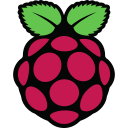

C / C++ · Raspberry Pi Pico W · PSoC 5 / PSoC Creator · GPIO / ADC · sensors · UART / serial · Bluetooth · PCB work · LTspice

Hands-on experience through engineering coursework and device projects. The featured lab demonstrates simulation software.

### AI-assisted development

 &nbsp; 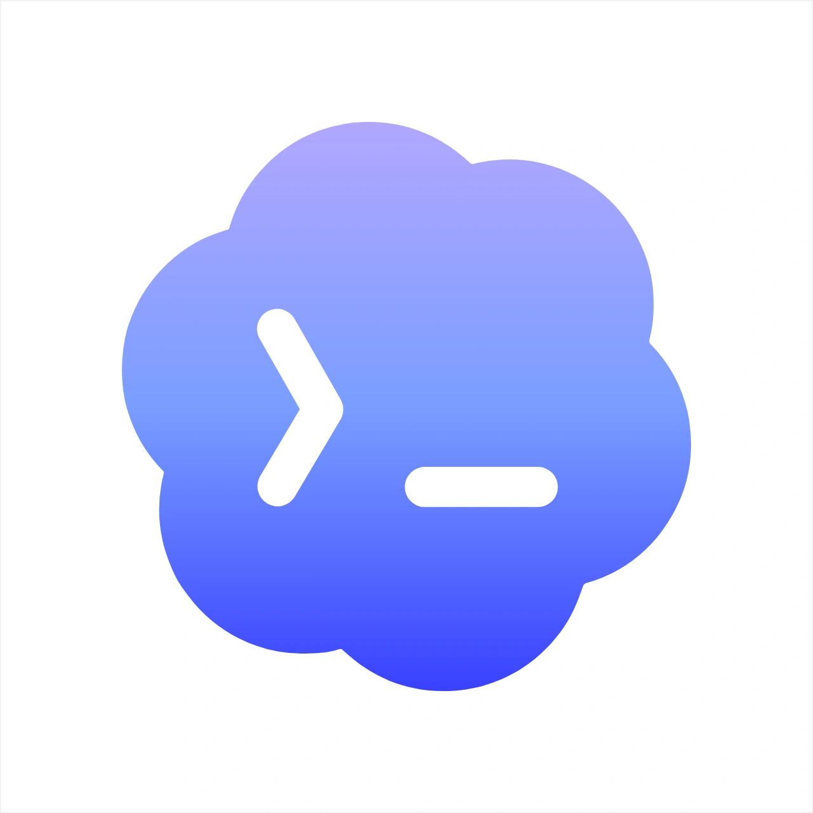 &nbsp;  &nbsp; 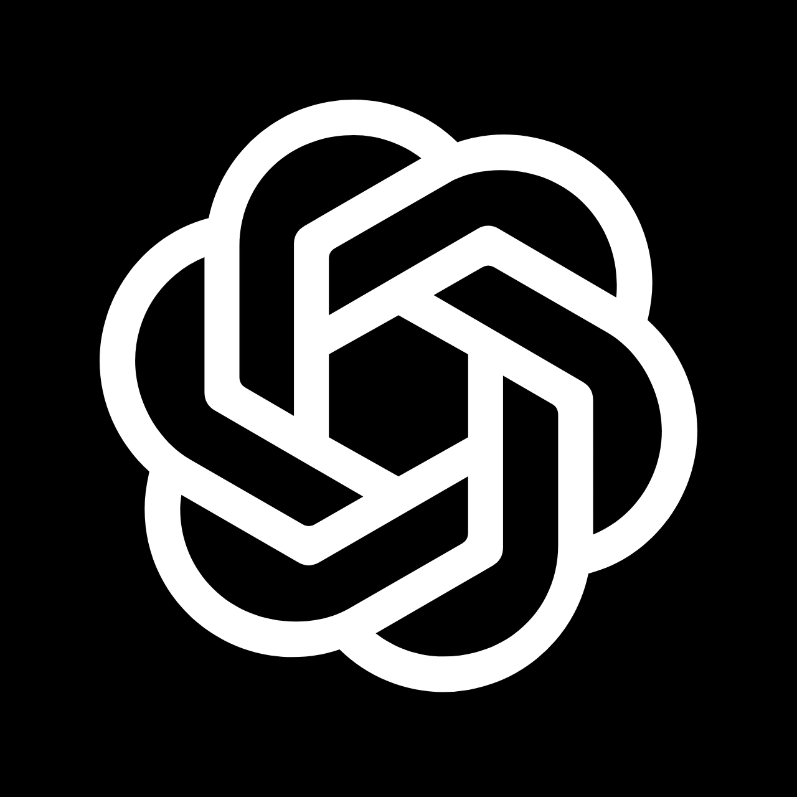 &nbsp; 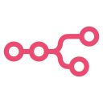

Claude Code · Codex · GitHub Copilot · ChatGPT · Cursor · n8n

I work with LLMs and generative AI to accelerate development, from exploring an approach to writing and debugging code. AI-assisted development is part of how I work.

## Let's connect

For my broader experience, project history or a conversation: **[find me on LinkedIn ↗](https://www.linkedin.com/in/ammaar-marzook-nz/)**

> "Most people have dreams. Some turn them into plans. Some act on those plans. Very few stay consistent long enough to succeed."
