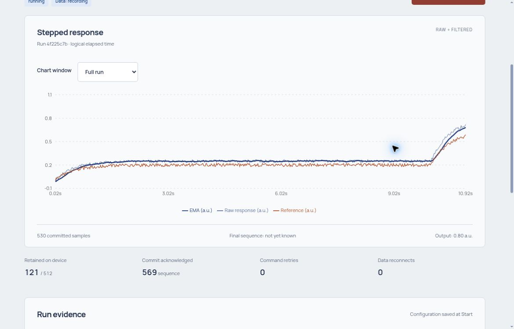
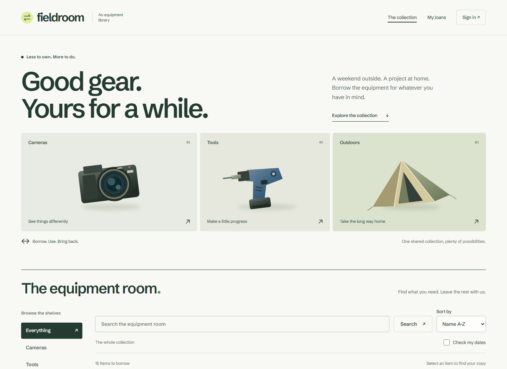

# Hi, I'm Ammaar

I build software that makes complex tasks easier to manage, from running simulated experiments to sharing equipment and staying focused online.

**Software · Firmware & systems · AI**  
Auckland, New Zealand

## Selected work

Start with the [Remote Experiment Control Lab walkthrough](https://github.com/ammaar134/Remote-Expriment-Control-Lab/blob/main/docs/WALKTHROUGH.md) for a tour of the interface and the engineering behind it.

### 01 / Remote Experiment Control Lab

An experiment console for configuring simulated experiments, watching measurements live and replaying saved results.

Repeatable simulations use a fixed seed and logical time steps. Stop waits for the engine's confirmation; saved-data replay sends no control commands.

React / TypeScript · Python / FastAPI · C++ simulation engines · PostgreSQL

[View source](https://github.com/ammaar134/Remote-Expriment-Control-Lab) · [Walkthrough](https://github.com/ammaar134/Remote-Expriment-Control-Lab/blob/main/docs/WALKTHROUGH.md) · [Architecture](https://github.com/ammaar134/Remote-Expriment-Control-Lab/blob/main/docs/ARCHITECTURE.md)

Simulator only. No physical hardware or hard real-time guarantees. The hosted app requires operator access; the screenshot and walkthrough are public.

Engineering notes: retries, recording and fault handling

Command retries preserve the same ID and payload. A bounded cache returns the previous response and rejects conflicting reuse. The engine sets simulated output to zero on Stop or fault; this is not a hardware emergency stop.

Recording is tracked separately from execution. Samples are acknowledged after database commit, and missing evidence remains explicit after a restart. Replay reads saved observations rather than running the simulation again.

[Command path](https://github.com/ammaar134/Remote-Expriment-Control-Lab/blob/main/backend/lab/instrument.py) · [C++ engine tests](https://github.com/ammaar134/Remote-Expriment-Control-Lab/blob/main/instrument/tests/engine_test.cpp) · [Reliability checks](https://github.com/ammaar134/Remote-Expriment-Control-Lab/blob/main/docs/TESTING.md) · [CI runs](https://github.com/ammaar134/Remote-Expriment-Control-Lab/actions/workflows/ci.yml)

### 02 / Fieldroom

An equipment-lending app that helps a club manage bookings, pickup, returns and maintenance without promising the same item to two people.

Overlapping reservations are rejected by the database. Booking changes and their audit history are saved together, so staff can trace what happened.

React / TypeScript · C# / ASP.NET Core Identity · EF Core · PostgreSQL

[View source](https://github.com/ammaar134/Live-Event-Operations) · [Case study](https://github.com/ammaar134/Live-Event-Operations/blob/main/docs/CASE-STUDY.md) · [Local walkthrough](https://github.com/ammaar134/Live-Event-Operations#walkthrough)

Portfolio application for a fictional club. Runs locally; no commercial deployment is claimed.

Engineering notes: booking conflicts and retry safety

A PostgreSQL exclusion constraint guards against overlapping occupancy, including maintenance and turnaround time. Row locks serialize competing changes; expiry uses database time sampled after the lock is acquired.

Each allocation change commits its audit event and retry outcome in the same transaction. Failed rescheduling preserves the original reservation. Tests race separate database connections and check that direct SQL cannot bypass the overlap guard.

[Allocation service](https://github.com/ammaar134/Live-Event-Operations/blob/main/src/Api/Features/AllocationService.cs) · [Concurrency tests](https://github.com/ammaar134/Live-Event-Operations/blob/main/tests/Api.Tests/ConcurrencyTests.cs) · [Architecture](https://github.com/ammaar134/Live-Event-Operations/blob/main/docs/ARCHITECTURE.md) · [CI runs](https://github.com/ammaar134/Live-Event-Operations/actions/workflows/verify.yml)

### 03 / EduFeed

A YouTube focus extension for people who want their homepage to show subscriptions or selected educational content instead of algorithmic recommendations.

Switch between focus modes and filter distractions such as Shorts. Preferences stay in the browser's local storage.

JavaScript · HTML / CSS · Chrome Manifest V3

[Install from the Chrome Web Store](https://chromewebstore.google.com/detail/edufeed-%E2%80%93-productive-yout/cpppgdcmmigbddkhaaifjfmogcppoknd) · [View source](https://github.com/ammaar134/edufeed) · [Modes and features](https://github.com/ammaar134/edufeed#the-three-modes)

Engineering notes: browser integration and current limits

The content scripts handle YouTube's in-page navigation and changing DOM. Feed loading distinguishes signed-out, network and parsing failures. Settings use <code>chrome.storage.local</code>; the manifest limits host access to YouTube.

The store listing is available, but the public repository still has stale release wording and missing demo/icon assets. YouTube layout changes can affect the extension. A store package-to-source comparison has not been established here.

[Feed replacement](https://github.com/ammaar134/edufeed/blob/main/src/content/feed-replacer.js) · [Manifest](https://github.com/ammaar134/edufeed/blob/main/manifest.json) · [Utility tests](https://github.com/ammaar134/edufeed/blob/main/test/utils.test.js)

## What I work with

Languages used in the projects above: TypeScript, JavaScript, Python, C++ and C#.

  &nbsp;
  &nbsp;
  &nbsp;
  &nbsp;
  

Application stack: React, FastAPI, .NET and PostgreSQL. Docker supports reproducible local environments.

  &nbsp;
  &nbsp;
  &nbsp;
  &nbsp;
  

My background also includes embedded development and hardware integration. The public systems example here is simulation software. AI is an active learning area, including AI-assisted development; these projects do not claim model training or deployment.

## Explore further

For an engineering conversation, start with the [lab walkthrough](https://github.com/ammaar134/Remote-Expriment-Control-Lab/blob/main/docs/WALKTHROUGH.md) or [Fieldroom case study](https://github.com/ammaar134/Live-Event-Operations/blob/main/docs/CASE-STUDY.md).

Praise be to God.
